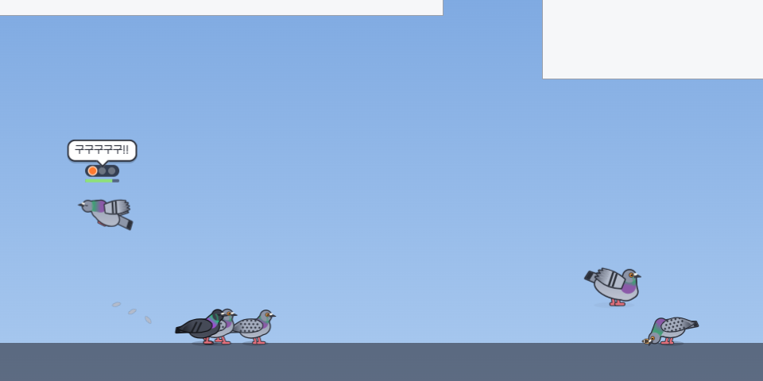

# 🕊 비둘기 모니터

자리를 비우면 내 화면에 비둘기가 날아와 **창 위나 화면 아래(작업 표시줄·Dock 위)** 에 앉는 데스크톱 펫.
마우스를 휘두르면 날아가고, 모이를 뿌리면 한두 마리씩 모여들고, 클릭해서 날아오른 비둘기를 쫓아가 맞히면 **생포**해서 도감을 채울 수 있어요.

## 다운로드

- 맥 13 이상 (애플 실리콘·인텔): [PigeonMonitor-mac.dmg](https://github.com/kanchoooo/pigeon-monitor/releases/latest/download/PigeonMonitor-mac.dmg)
- 윈도우 10/11: [PigeonMonitor-Setup.exe](https://github.com/kanchoooo/pigeon-monitor/releases/latest/download/PigeonMonitor-Setup.exe) — "Windows의 PC 보호" 창이 뜨면 **추가 정보 → 실행**
- 다운로드 페이지: https://kanchoooo.github.io/pigeon-monitor/ (`docs/index.html`)



- 맥 / 윈도우 (Electron 44 + TypeScript, 프레임워크 없음)
- 비둘기 그림: 이미지 파일 없이 캔버스 도형으로 그림 (`src/renderer/src/pigeon/draw.ts`)
- 효과음: WebAudio 합성 (`src/renderer/src/pigeon/sound.ts`)
- 다른 앱 창 위치: [koffi](https://koffi.dev) FFI — 맥은 CoreGraphics, 윈도우는 user32/dwmapi (`src/main/windows/`)

## 실행

```bash
npm install
node scripts/fetch-koffi.mjs   # 맥 x64/arm64 · 윈도우용 koffi 네이티브 모듈 (빌드 때만 필요)
npm run dev                    # 개발 모드
PIGEON_IDLE=5 npm run dev      # 5초만 가만히 있어도 비둘기가 오게 (테스트)
```

창을 닫아도 메뉴 막대(맥) / 작업 표시줄 트레이(윈도우)의 비둘기 아이콘으로 계속 실행돼요. 완전히 끄려면 트레이 메뉴 → 종료.

## 동작

| 상황 | 비둘기 |
|---|---|
| 컴퓨터 쓰는 중 | 안 옴 |
| 설정 시간(기본 1분) 동안 마우스·키보드 입력 없음 | 1~4초 뒤 첫 비둘기, 이후 6~18초마다 한 마리씩 (최대 수까지). 3~12분 머물다 교대 |
| 다시 돌아옴 | 한 마리가 "어 왔어?" 하고, 40~150초 안에 하나둘 떠남 |
| 마우스를 빠르게 휘두름 | 근처 비둘기가 놀라 날아감 (옆 비둘기도 덩달아) |
| 천천히 다가감 | 종종걸음으로 비켜섬. 커서를 오래 올려두면 슬금슬금 피함 |
| 창을 끌어 옮김 | 위에 앉은 비둘기도 같이 움직임. 창이 닫히거나 가려지면 푸드덕 다른 자리로 |
| 화면 잠금 | 그 자리에 멈춰 있다가, 잠금을 풀면 그대로 있음 |
| 전체화면 영상·발표·게임 | 새로 오지 않고 있던 비둘기도 곧 떠남 (설정에서 끌 수 있음) |

### 모이 주기
패널·트레이의 **🌾 모이 주기** → 화면 아무 데나 클릭하면 모이가 떨어져 창 위나 바닥에 쌓이고,
비둘기가 한두 마리씩 날아와 먹어요(닭둘기는 모이를 주면 3배 잘 와요).
끝내기: **ESC**, 우클릭, 화면 위 "그만 주기" 버튼. 1분 30초 동안 모이를 안 주면 저절로 끝나요(클릭이 막히지 않게).

### 생포 (추격)
비둘기를 클릭하면 푸드덕 날아올라 화면 안을 이리저리 도망다녀요. 쫓아가서 정해진 횟수만큼 맞히면 생포 → 도감 등록.
비둘기 위에 맞힌 횟수(●●○○○)와 남은 시간 막대가 떠요. 시간 안에 다음 클릭을 못 맞히면 "메롱 구구~" 하고 도망가요.

| 처음 클릭할 때 상태 | 필요한 클릭(첫 클릭 포함) | 나는 속도 | 다음 클릭까지 |
|---|---|---|---|
| 풀어준 비둘기 | 2번 | 아주 느림 | 4.5초 |
| 밥 먹는 중 | 3번 | 느림 · 공중에서 오래 멈칫 | 3.4초 |
| 졸고 있음 | 4번 | 보통 | 2.9초 |
| 평소 (앉아 있거나 내려앉는 중) | 5번 | 빠름 · 맞으면 휙 방향을 틂 | 2.6초 |

- 희귀할수록 더 맞혀야 하고 조금 더 빨라요 (희귀 +1, 영웅 +2, 전설 +3번).
- 맞을수록 지쳐서 느려져요. 평소 비둘기는 바로 옆을 헛클릭하면 움찔 피해요.
- 밥 먹다 도망간 비둘기는 모이가 남아 있으면 반쯤은 다시 먹으러 와요.
- 쫓는 비둘기 근처의 헛클릭은 뒤의 앱으로 넘어가지 않아요 (멀리 떨어진 곳은 그대로 넘어감).
- 값은 `src/renderer/src/overlay/pigeon.ts` 의 `CHASE` 에서 바꿀 수 있어요.

### 생포 기록 (리플레이 · 네컷 · 영상)
잡을 때마다 그 장면이 패널의 **🎬 생포 기록** 탭에 남아요 (최근 40개).
- **리플레이**: 쫓기기 직전 → 추격 → 마지막 한 방 슬로모션·클로즈업 → 번쩍 + '생포!' 도장 + 이름표(+ NEW).
- **📸 네컷 만들기**: 1080×1350 '비둘기 네컷' 사진 (① 평화 ② 도망 ③ 클로즈업 ④ 생포). 저장하면서 클립보드에도 복사.
- **🎬 영상 저장**: 1080×1080 MP4 (H.264 + 효과음). 실시간으로 그리며 녹화해서 10초 안팎 걸려요.
- 화면을 녹화하지 않고 비둘기 위치·자세·커서만 기록해 다시 그려요. 내 화면 내용은 담기지 않고 창 모양만 단순하게 그려요.
- 기록: `userData/replays/<id>.json` (`src/shared/replay.ts`), 그리기: `src/renderer/src/panel/replay.ts`.
도감에서 잡은 비둘기를 **풀어주기** 하면 화면에 다시 날아와 잠시 놀다 가요(도감 기록은 남음).
**📸 자랑하기** 는 1080×1350 도감 이미지를 클립보드에 복사하고 저장해요.

### 품종 (10종)

| 품종 | 희귀도 | 등장 가중치 |
|---|---|---|
| 회색 비둘기 · 체크무늬 비둘기 | 흔함 | 40 · 24 |
| 갈색 비둘기 · 흑둘기 · 닭둘기 | 보통 | 10 · 8 · 9 |
| 하얀 비둘기 · 공작 비둘기 · 선글라스 비둘기 | 희귀 | 4 · 3 · 2.2 |
| 왕관 비둘기 | 영웅 | 0.8 |
| 황금 비둘기 | 전설 | 0.25 (약 0.25%) |

색·무늬·대사는 `src/shared/breeds.ts`, `src/renderer/src/overlay/lines.ts` 에서 바꿀 수 있어요.

## 구조

```
src/main/
  index.ts       앱·트레이·패널 창·자리비움 판단(powerMonitor)·모이 주기·IPC
  overlays.ts    디스플레이마다 투명 전체화면 창 (클릭 통과, 비둘기 위에서만 클릭 받음)
  windows/buttons.ts  마우스 버튼 누름 읽기 (아래 '클릭 받기' 참고)
  perches.ts     창 목록 → 앉을 자리 (창 윗변 중 앞 창에 가리지 않은 구간 + 화면 바닥)
  windows/       창 위치 읽기 (mac.ts: CoreGraphics, win.ts: user32 + DWM)
  store.ts       설정·도감·통계 (userData/state.json)
src/renderer/src/
  pigeon/        비둘기 그리기·효과음 (패널과 오버레이가 같이 씀)
  overlay/       비둘기 세상: world(자리·등장·커서·클릭) · pigeon(상태 머신) · food · fx · lines
  panel/         패널 UI(홈·도감·생포 기록·설정) · 도감 자랑 이미지 · 리플레이/네컷/영상
  lab/           그림 확인용 페이지 (앱에는 안 들어감)
```

맥은 창 위치·크기만 읽어서 **화면 기록 권한이 필요 없어요** (창 제목은 읽지 않음).
창 목록을 못 읽는 환경이면 화면 바닥에만 앉아요.

### 클릭 받기 (윈도우 주의)
오버레이는 포커스를 가져가지 않는 창(`focusable: false`)이에요. 윈도우에서 이런 창을 클릭하면 Chromium 이
`WM_MOUSEACTIVATE` 에 `MA_NOACTIVATEANDEAT` 로 답해서 **클릭이 버려지고 렌더러에 pointerdown 이 오지 않아요**
(마우스 이동은 와요 → 쫓기는 되는데 모이·생포가 안 되던 원인).
그래서 메인이 60Hz 로 버튼 상태를 직접 읽어(`GetAsyncKeyState`, 맥은 `NSEvent.pressedMouseButtons`)
클릭을 받는 중인 오버레이에 `world:press` 로 알려 줘요. 맥처럼 pointerdown 도 오는 곳에서는 둘 중 하나만 써요
(`overlay/main.ts` 의 `press()`). 클릭은 그대로 오버레이가 먹으니 뒤의 앱으로 새지 않고, 포커스도 뺏지 않아요.

## 테스트 (헤드리스)

화면에 띄우지 않고 가짜 화면(1440×900)과 가짜 창 3개로 돌려서 PNG 로 확인합니다. 환경변수 목록은 `src/main/env.ts`.

```bash
npm run build
# 시나리오: 부르기 → 모이 → 생포 추격 → 휘둘러 쫓기
PIGEON_HEADLESS=1 PIGEON_SCRIPT=test.json PIGEON_SHOT_DIR=shots npx electron .
# test.json 예: [{"at":600,"summon":5},{"at":5000,"shot":"landed"},{"at":8200,"feed":true},
#                {"at":8500,"click":[400,110]},{"at":15000,"chase":[3,400]},{"at":16300,"shot":"caught"},{"at":16500,"quit":true}]
# 윈도우 경로 흉내: {"press":[x,y,0]} (메인이 읽은 클릭), {"chase":[9,320,"press"]}
# 패널: {"panelJs":"document.querySelectorAll('.tab')[2].click()"}, {"panelShot":"album"}
#       PIGEON_SAVE_DIR=폴더 면 네컷·영상 저장 대화상자 없이 바로 저장
PIGEON_LAB=sheet PIGEON_SHOT=sheet.png npx electron .      # 품종 × 자세 표
PIGEON_LAB=icon PIGEON_SIZE=1024x1024 PIGEON_SHOT=build/icon.png npx electron .   # 앱 아이콘 다시 만들기
PIGEON_SELFTEST=1 dist/mac-universal/PigeonMonitor.app/Contents/MacOS/PigeonMonitor # 패키징된 앱에서 koffi 확인
```

## 빌드·배포

| 명령 | 결과 |
|---|---|
| `npm run dist:mac` | 맥 유니버설 dmg + zip, Developer ID 서명 + 공증 (`dist/PigeonMonitor-mac.dmg`) |
| `npm run dist:mac:local` | 서명 없이 내 맥용 .app |
| `npm run dist:win` | 윈도우 설치 파일 (맥에서도 빌드됨, 서명 없음) `dist/PigeonMonitor-Setup.exe` |
| `npm run release` | 버전 올리고 GitHub Releases 에 맥·윈도우 올려 공개 (자동 업데이트) |

- 맥 서명·공증은 **미니미 광장과 같은 인증서**(`~/.minimi-signing/`)와 공증 프로필(`minimi-notary`)을 씁니다.
  `scripts/build-mac.mjs` 는 미니미 광장과 같은 잠금(`~/.minimi-signing/.build.lock`)을 써서 두 서명 빌드가 동시에 돌지 않고,
  임시 키체인(`pigeon-build.keychain-db`)은 검색 목록 맨 뒤에만 붙였다가 끝나면(실패·Ctrl+C 포함) 빼고 지웁니다.
- 윈도우는 서명 없이 배포 → 설치할 때 "Windows의 PC 보호" → **추가 정보 → 실행**.
- `npm run release` 가 버전 올리기 → 태그 push → 맥 서명·공증·업로드 → (GitHub Actions 가 만든) 윈도우 설치 파일을 기다렸다가 릴리스 공개까지 해요.
  윈도우 설치 파일은 태그가 올라가면 `.github/workflows/release.yml` 이 만들어요. 설치된 앱은 6시간마다 새 버전을 확인해 자동 업데이트해요.

고정 다운로드 주소 (새 버전이 나와도 그대로):
- 맥: `https://github.com/kanchoooo/pigeon-monitor/releases/latest/download/PigeonMonitor-mac.dmg`
- 윈도우: `https://github.com/kanchoooo/pigeon-monitor/releases/latest/download/PigeonMonitor-Setup.exe`

## 저작권

- 비둘기 그림·효과음은 모두 코드로 만든 오리지널.
- 글꼴: [갈무리(Galmuri)](https://github.com/quiple/galmuri) — SIL Open Font License 1.1 (`src/renderer/src/assets/fonts/ofl.md`)
